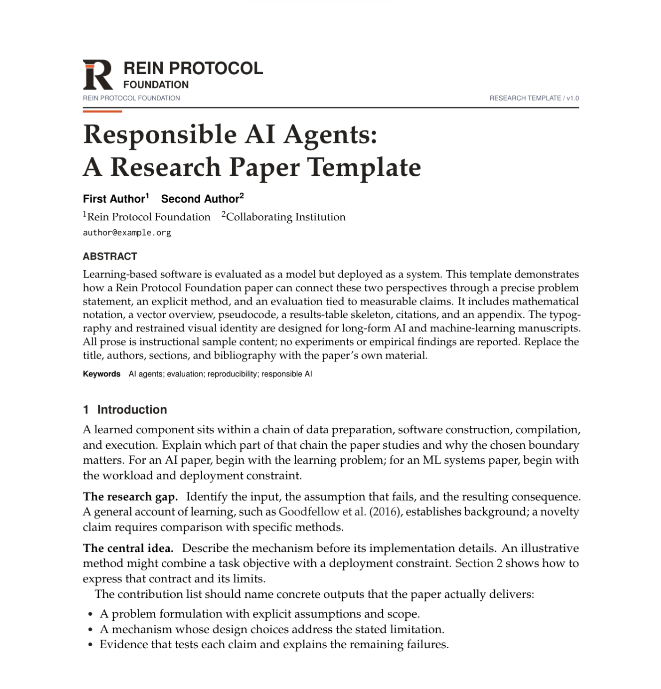
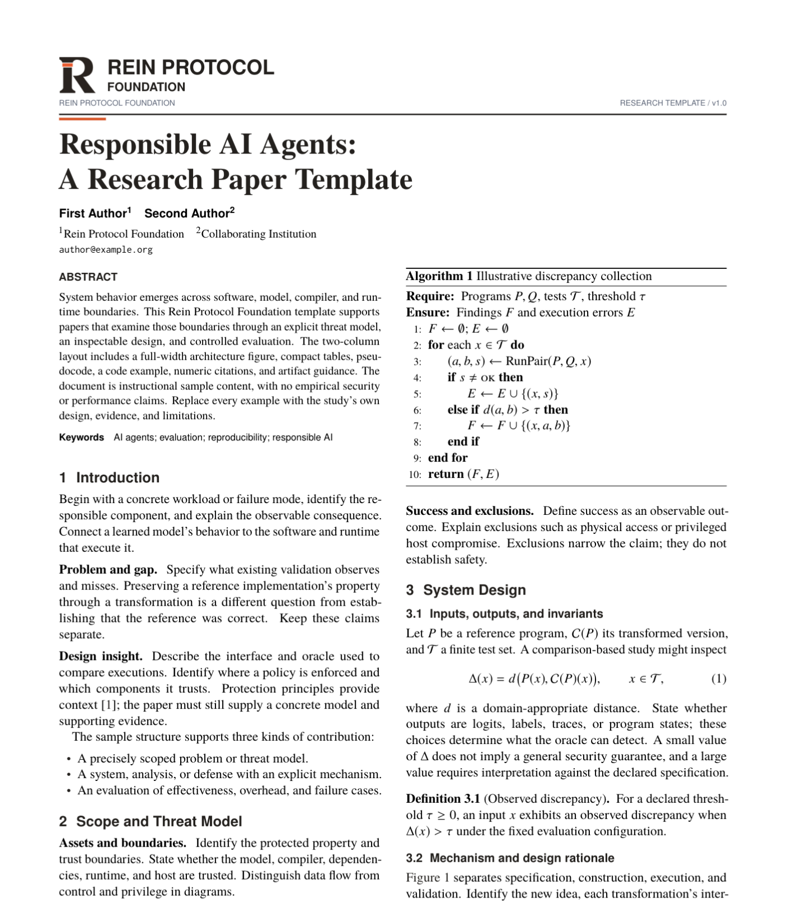

# rein-paper-template

Rein Protocol Foundation 的 LaTeX 论文模板，适合录用后的作者版本、技术报告与预印本。使用官网现有 R 标识、Foundation 英文全称与暖黑/橙色配色。

## 模板效果预览

以下为单栏与双栏模板的首页截图，点击图片可查看大图。

| 单栏 · 作者–年份引用 | 双栏 · 数字引用 |
| --- | --- |
| [](docs/previews/single-column.png) | [](docs/previews/double-column.png) |
| [查看完整单栏 PDF](output/REIN-single-column.pdf) | [查看完整双栏 PDF](output/REIN-double-column.pdf) |

## 从 GitHub 创建自己的论文仓库

点击本仓库的 **Use this template → Create a new repository**，即可在自己的账号或组织下创建论文仓库。

## 直接使用

下载 `output/REIN-complete-Overleaf-kit.zip` 并上传 Overleaf。选择 **pdfLaTeX**：

- `main.tex`：单栏，作者–年份引用。
- `main-double.tex`：双栏，数字引用。

只需要一种版式时，下载对应的 `REIN-single-column-Overleaf.zip` 或 `REIN-double-column-Overleaf.zip`，其入口均为 `main.tex`。`output/` 同时提供两份 PDF 预览。

## 改成自己的论文

1. 编辑 `paper-info-single.tex` 或 `paper-info-double.tex`：题目、真实作者、单位、邮箱、短标题、关键词。
2. 将 `\reinstatus{RESEARCH TEMPLATE}` 改为 `\reinstatus{AUTHOR ACCEPTED MANUSCRIPT}`，填写真实版本号。模板本身没有录用声明。
3. 用实际论文替换 `sections/single/` 或 `sections/double/` 中的教学示例；替换 `references.bib`、插图与实验结果。
4. 在正文添加真实会议/期刊名称、年份、DOI 及需要的出版说明。按出版方允许的作者版本与格式要求上传；本模板不替代会议官方 camera-ready 样式。
5. 按需启用 `\reinproject[标签]{URL}`、`\reingithub{URL}`、`\reindataset[标签]{URL}`。这些链接默认不显示，不要把机构首页误作论文实验资源。

Foundation 官网：https://rein-protocol.org 。示例作者和邮箱均为占位符，不代表实际作者或研究成果。

## 可选功能

- `\reinorcid{真实 ORCID}`：在作者名后添加 ORCID 链接。
- `\reinpartner{机构名称}{assets/partner-logo.pdf}`：添加合作机构 Logo；默认隐藏。
- `\reinacknowledgments{...}`：致谢。
- `anonymous` 类选项：隐藏模板管理的作者、机构、Logo、资源链接、致谢与身份元数据。正文、自引和自带图片仍需自行检查。
- `monochrome` 类选项：正文使用灰度配色；正式 Logo 保留原始品牌颜色。

共享类为 `reinpaper.cls`，命令前缀为 `\rein`；公式中的 `\star` 仍是数学符号。

## 本地编译与打包

```bash
git clone https://github.com/rein-protocol-foundation/rein-paper-template.git
cd rein-paper-template
python3 scripts/build.py
python3 scripts/package.py
```

编译需要 TeX Live/MacTeX 的 `latexmk` 与 pdfLaTeX，或 `python3 scripts/build.py --engine tectonic`。中间文件保存在忽略的 `build/`，PDF 和自包含 ZIP 写入 `output/`。ZIP 不包含私有资料、构建缓存或他人的论文。

## 来源

上游来源、固定版本与授权状态见 [PROVENANCE.md](PROVENANCE.md)。来源说明不出现在论文排版中。此目录独立于网站代码，不依赖 Node.js 或 Next.js。
